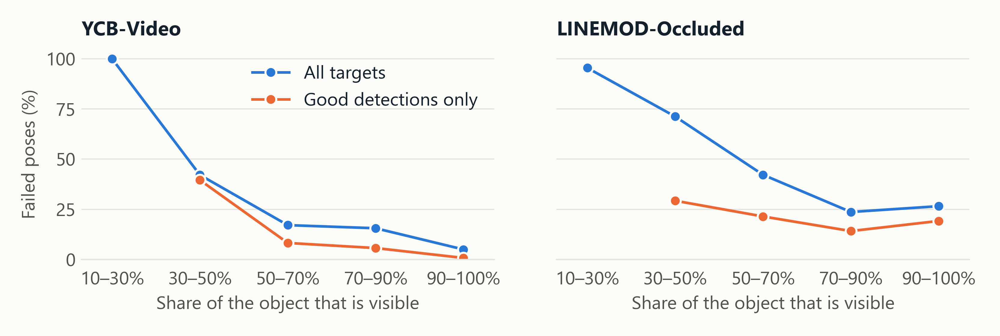
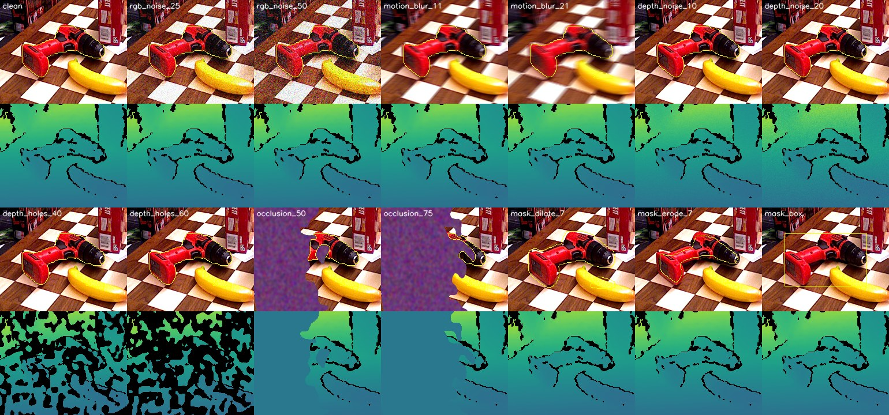
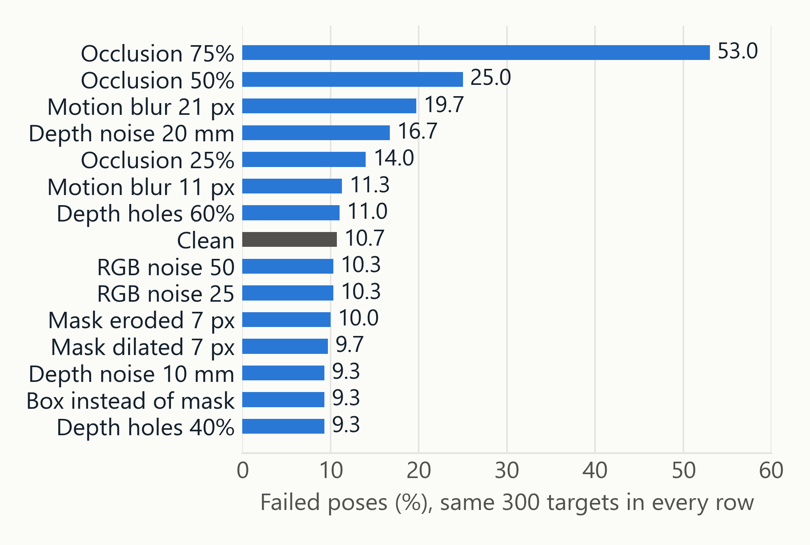
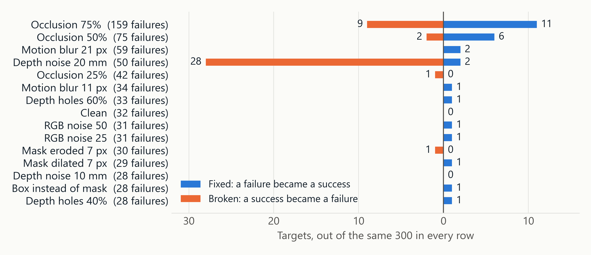
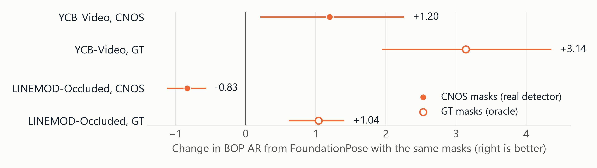
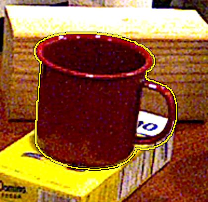
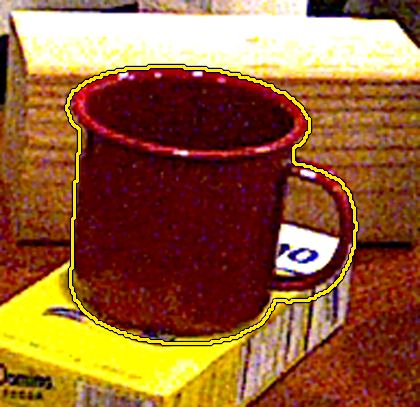
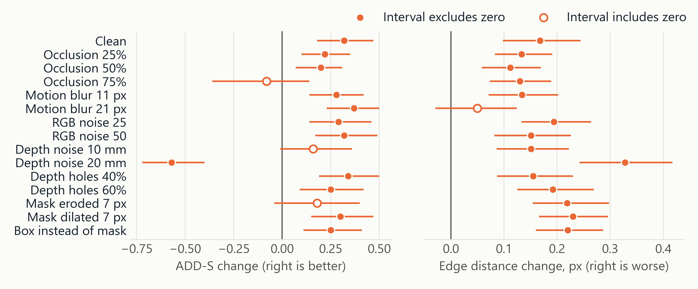

# Does differentiable rendering improve FoundationPose? Testing our hypothesis

Track: Differentiable Rendering. Group 4: Jonathan Nazario, David Tran. Deeper analysis: Sensitivity.

This report follows the proposal's hypothesis from start to finish: what we expected, how each experiment tests part of it, and what the evidence says. The full tables are in [REPORT.md](REPORT.md).

## The answer in brief

Our hypothesis had two parts. The first, that FoundationPose has identifiable failure points, held, with one surprise: detection matters far more than the factors we listed. The second, that differentiable rendering would improve performance once we found those weaknesses, held only weakly overall and failed at the weaknesses themselves. A blinded human check also suggests that the overall gain may not be a better fit to the image.

| Part of the hypothesis | Verdict | Key evidence |
|---|---|---|
| H1. FoundationPose has findable weak points | Supported, with a surprise | Occlusion and severe blur confirmed; viewing angle not; bad detections cause 60-69% of failures |
| H2a. Differentiable rendering improves overall accuracy | Weakly, on one dataset | AR +1.05 on YCB-Video; -0.83 on LINEMOD-Occluded |
| H2b. It improves the weak points | Not supported | Fixes 5 of 326 failures on clean data; breaks 28 good poses at heavy depth noise |
| Risk: "the model may already perform well enough" | Largely came true | With a good detection, FoundationPose reaches AR 92.3 on YCB-Video |

## 1. The hypothesis

The proposal says FoundationPose estimates an object's 3D position and orientation from a CAD model and an RGB-D image, and sets out two goals: find its points of failure ("certain angles, partial occlusion, motion blur, etc."), then improve performance there with a differentiable rendering algorithm. Success was to be measured against the datasets' ground-truth poses.

We split that into testable claims:

- **H1:** FoundationPose's errors concentrate under specific conditions, and we can identify them.
- **H2a:** Adding differentiable-rendering refinement after FoundationPose improves accuracy against ground truth.
- **H2b:** The improvement is concentrated at, or at least present at, the failure points from H1.

The proposal also listed a risk that frames the result: the model may already perform well enough, or differentiable rendering may not help at all.

## 2. How we measured

### Data and setup

We used the BOP versions of two standard benchmarks: **YCB-Video** (900 test images, 4,123 object instances, which we call targets) and **LINEMOD-Occluded** (200 images, 1,445 targets, with heavily occluded objects). We used the released FoundationPose code and weights on one RTX 3070.

FoundationPose needs a mask telling it where the object is. We used **CNOS**, a detector that needs no training on these objects, because that is how the system would run in practice. BOP also ships ground-truth masks, but those are drawn from the true pose, so they appear here only as a labeled **oracle**: an upper bound, never a result.

To avoid tuning on the answers, we split YCB-Video by scene before any experiments: 3 scenes for development and 9 for testing. All refiner settings were chosen on the development scenes and frozen in `results/frozen_config.json` before the test scenes were opened. LINEMOD-Occluded was never used for tuning at all, so it tests whether results transfer.

### Metrics

We evaluate the four pose metrics below, plus a failure definition and an uncertainty method.

**ADD and ADD-S.** These measure how far the object's surface points land from where they should be: the average distance in millimeters between each model point placed at the estimated pose and at the true pose. ADD-S matches each point to the nearest point instead of the same point, so a symmetric object such as a can isn't penalized for an equivalent rotation. We report the **AUC**, the area under the curve of "fraction of targets with error below *x*" for *x* from 0 to 10 cm, scaled to 100. Higher is better, and a perfect score means every pose is exact.

**BOP Average Recall (AR).** This is the official benchmark score, and the number the FoundationPose paper reports. It averages three error measures, each judged at ten thresholds:

- **VSD (visible surface discrepancy)** renders depth images of the object at the estimated and true poses and compares only the visible part. It asks whether the visible surface lands at the right depth. It is the measure most sensitive to depth alignment.
- **MSSD (maximum symmetry-aware surface distance)** is the worst 3D error of any surface point, in units of the object's diameter. It matters for robot grasping, where the worst point is what collides.
- **MSPD (maximum symmetry-aware projection distance)** is the worst error in pixels after projecting into the image. It matters for augmented reality, where the overlay must line up on screen.

AR is the mean of the three recall scores, from 0 to 100.

**Failure.** We call a pose a failure when its worst surface point is off by more than 10% of the object's diameter (MSSD over 0.1 diameter). This turns a continuous error into a yes-or-no outcome we can count.

**Confidence intervals.** Every comparison is **paired**, meaning both methods run on exactly the same targets, so differences in difficulty cancel out. Intervals come from a **cluster bootstrap**: we resample whole groups of frames (one object in one video) instead of single frames, because consecutive video frames are nearly identical and would otherwise make the intervals falsely narrow. Brackets in this report are 95% intervals. An interval that excludes zero means the direction of the change is reliable.

## 3. Is the baseline trustworthy?

**What it tests.** Before blaming or crediting anything, our pipeline has to reproduce the published numbers. If it doesn't, every later result is suspect.

| Dataset | Ours, CNOS masks | Paper, Mask R-CNN masks | Ours, GT masks (oracle) |
|---|---|---|---|
| YCB-Video | 86.2 | 88.0 | 91.8 |
| LINEMOD-Occluded | 67.4 | 78.8 | 81.7 |

YCB-Video lands 1.8 points under the paper, which fits the known differences: a different detector, 252 pose hypotheses in the released code against the paper's 504, and released weights trained without the paper's extra data. LINEMOD-Occluded was 11.4 points under, large enough to suspect a bug. So we reran all 1,445 targets with GT masks. AR rose by +14.28 [+11.28, +17.12], past the paper. On both datasets the published figure sits between our two mask sources, so our scoring is sound and LINEMOD-Occluded's gap comes from the masks. We did not run Mask R-CNN ourselves, so the exact split of the remaining gap isn't measured.

## 4. H1: Does FoundationPose have identifiable weak points?

### Detection quality

**What it tests.** FoundationPose only estimates pose inside the mask it's given. If the detector misses the object or outlines the wrong thing, the pose fails no matter how good the estimator is. Splitting failures by mask quality (IoU, the overlap between the detector's mask and the true visible region) separates the detector's mistakes from the pose estimator's.

| Dataset | Failures | Caused by a bad detection (none, or IoU under 0.5) | AR with a good detection | AR with a bad one |
|---|---|---|---|---|
| YCB-Video | 392 of 4,123 (9.5%) | 272 (69%) | 92.3 | 31.2 |
| LINEMOD-Occluded | 511 of 1,445 (35.4%) | 307 (60%) | 85.1 | 10.6 |

Detection is the largest single factor, and the proposal didn't list it. Targets with good detections are also easier in other ways, so this split shows association, not cause. The GT-mask rerun above is the more direct evidence.

### Occlusion

**What it tests.** Partial occlusion was one of our named suspects. BOP records what fraction of each object is visible, so we can bin targets by visibility and watch the failure rate. Repeating the plot with good detections only shows how much of the occlusion effect is really detection.

*Failure rate by visible fraction. Blue is every target; orange keeps only good detections, which are too few to plot below 30% visible.*

| Visible | YCB-Video, all | YCB-Video, good detections | LINEMOD-Occluded, all | LINEMOD-Occluded, good detections |
|---|---|---|---|---|
| 10-30% | 100% | too few | 95% | too few |
| 30-50% | 42.1% | 39.6% | 71.2% | 29.3% |
| 50-70% | 17.1% | 8.2% | 42.2% | 21.4% |
| 70-90% | 15.6% | 5.7% | 23.7% | 14.2% |
| 90-100% | 5.0% | 0.8% | 26.6% | 19.2% |

Occlusion is confirmed as a weak point. On LINEMOD-Occluded much of it is detection: with good masks the curve flattens. Even fully visible LINEMOD-Occluded objects fail about 19% of the time with good masks, against 0.8% on YCB-Video, so that dataset is harder for reasons beyond occlusion.

### Viewing angle

**What it tests.** Our first suspect was "certain angles." We computed where the camera sits relative to each object (its elevation above or below the object's own equator) and binned failures by it, on good detections only so detection doesn't muddy the answer.

| Camera elevation | YCB-Video failures | LINEMOD-Occluded failures |
|---|---|---|
| -90 to -30 degrees | 0% (527 targets) | too few to bin |
| -30 to 0 | 0% (416) | too few to bin |
| 0 to 30 | 5.2% (1,817) | 21% (487) |
| 30 to 60 | 2.8% (907) | 17.4% (453) |
| 60 to 90 | 0% (47) | 13.2% (159) |

Viewing angle is not supported as a major weak point. Failures vary by a few points across angles, far less than across visibility or detection quality.

### Added obstacles

**What it tests.** Natural images mix many difficulties at once. To isolate each one, we took the same 300 held-out YCB-Video targets and applied one controlled corruption at a time: synthetic occluders, motion blur, color noise, depth noise, missing depth, and damaged masks. Because the targets are identical in every row, any change in failure rate is caused by that corruption alone.

*The corruptions on one frame: color image with the mask outline (top) and depth (bottom), for each condition.*

*FoundationPose's failure rate under each condition. Grey is the clean rate.*

The worst failure points are heavy occlusion (53.0% at 75%, five times the clean 10.7%), severe motion blur (19.7% at 21 px; 11 px barely matters at 11.3%), and heavy depth noise (16.7% at 20 mm). FoundationPose is robust to color noise, missing depth and rough masks, even a plain bounding box instead of a mask.

### Objects

The worst YCB-Video objects, the two clamps (objects 19 and 20) and object 7, fail 33-54% of the time with CNOS masks and 0% with GT masks, on the 13 to 15 targets of each where we have both. These, too, are detection problems.

### Verdict on H1

**Supported, with a surprise.** Partial occlusion and severe motion blur are real weak points, viewing angle is not, and the biggest weakness, detection, wasn't on our list. These were the failure points we carried into H2.

## 5. The differentiable renderer we built

### How it works

**What it does.** A differentiable renderer draws an image of the 3D model at a given pose in a way that also tells you how the image would change if the pose moved slightly. That lets us compare the drawing with the real sensor image and use gradients to nudge the pose until they agree. Our refiner starts from FoundationPose's final answer and repeats four steps:

1. **Render** the model's depth at the current pose with nvdiffrast (we reused this library instead of writing a renderer from scratch).
2. **Compare** it with the sensor's depth inside the detector's mask, using a robust cost that caps how much any single outlier or occluder can count.
3. **Differentiate** the mismatch through the renderer to get a gradient for the pose.
4. **Step** the rotation and translation with the Adam optimizer.

After 30 steps it keeps the best pose it saw, and it keeps FoundationPose's original pose if nothing improved. It never sees ground truth, and it adds about 0.3-0.5 s per target to FoundationPose's 2.4-3.2 s.

### Choosing what to compare

**What it tests.** A renderer can compare depth, color, or silhouette (the object's outline). We tested each term alone on the development scenes, measuring the change in ADD-S AUC across 150 targets.

| Comparison term | Change in ADD-S |
|---|---|
| Depth, final settings | +0.18 [+0.07, +0.32] |
| Depth, first settings | +0.16 |
| Color only | -2.70 |
| Silhouette only | -6.57 |

Only depth helped, so the frozen refiner compares depth alone (with a 3 mm noise scale and 30 steps).

### A trap: silhouettes against BOP's masks

**What it tests.** A silhouette term fits the rendered outline to a mask. If that mask were drawn from the true pose, fitting it would copy the answer. We measured how much this matters by adding the silhouette term on top of depth, with each kind of mask, on the 300 held-out targets.

| Masks the silhouette is fitted to | Change in AR |
|---|---|
| GT masks (drawn from the true pose) | +1.52 [+1.03, +2.07] |
| CNOS masks (a real detector) | -0.49 [-1.34, +0.13] |

The silhouette term looks useful only when the mask leaks the answer. Any refinement scored against BOP's own masks would be measuring this leak.

### Controls

**What they test.** A gain from refinement could come from simply spending more computation on each pose. We ran two compute-matched controls on the same targets:

- **ICP (iterative closest point)** aligns the model's points with the sensor's depth points directly, with no renderer. If ICP matched our refiner, the renderer wouldn't be what helps.
- **More FoundationPose iterations** runs FoundationPose's own refinement network longer. If this matched our refiner, the gain would be extra compute rather than our method.

## 6. H2: Does differentiable rendering improve the pose?

### H2a: overall, on held-out YCB-Video

**What it tests.** The planned comparison: the same targets, before and after refinement, on the test scenes no setting was tuned on.

| Change from FoundationPose | AR | ADD-S | MSPD |
|---|---|---|---|
| Refiner, all 3,000 test targets | +1.05 [+0.27, +1.81] | +0.25 [+0.14, +0.37] | +1.38 [+0.51, +2.15] |
| Refiner, 300 targets | +1.20 [+0.21, +2.26] | +0.32 [+0.18, +0.47] | +1.27 [+0.20, +2.48] |
| ICP, 300 targets | -0.82 [-3.29, +1.32] | +0.02 [-0.42, +0.35] | -1.37 [-4.58, +1.25] |
| More iterations, 300 targets | +0.06 [-0.27, +0.41] | +0.00 [-0.04, +0.05] | +0.20 [-0.48, +0.95] |

AR rises from 84.88 to 85.93. Compared directly, the refiner leads ICP by +2.01 [+0.30, +4.21] AR and leads extra iterations by +1.14 [+0.18, +2.13], so the gain comes from render-and-compare rather than compute. It is small, though: about one point, with 61% of targets improving and 29% getting worse. VSD moves most (+1.43), which fits a refiner that aligns depth, while the worst-point measure MSSD shows no clear change (+0.34 [-0.07, +0.79]).

### H2b: at the failure points

**What it tests.** H2b says refinement should help where FoundationPose fails. The direct measure is to count, under each condition, how many failures refinement **fixed** (a failure became a success) and how many good poses it **broke** (a success became a failure).

*Fixed (blue, right) against broken (orange, left), out of the same 300 targets per condition. The labels give FoundationPose's failure count.*

Refinement barely touches the failure points:

- On all 3,000 clean test targets it fixes **5 of 326** failures and breaks 2.
- At 75% occlusion it fixes 11 of 159 failures and breaks 9 good poses.
- At 20 mm depth noise it fixes 2 and **breaks 28**. ADD-S falls 0.57 [-0.72, -0.40] and MSPD falls 5.03 [-6.19, -3.94], because the refiner faithfully follows noisy depth.

By visibility, on all 3,000 clean targets, the gain shows up on well-visible objects and not on hidden ones:

| Visible | Targets | ADD-S change |
|---|---|---|
| Under 50% | 88 | -0.48 [-0.76, +0.19], inconclusive (5 clusters) |
| 50-70% | 219 | +0.32 [+0.03, +0.60] |
| 70-90% | 660 | +0.30 [+0.13, +0.49] |
| 90-100% | 2,033 | +0.25 [+0.13, +0.38] |

This is what a local search should do. It nudges a pose that is nearly right, and it cannot rescue a pose that is badly wrong. That answers the proposal's open question of whether to focus on failure points or overall performance: our refiner helps overall performance slightly and does not help at the failure points.

### Does it transfer?

**What it tests.** A method tuned on one dataset might just fit that dataset's quirks. Running the frozen refiner on LINEMOD-Occluded, which was never used for tuning, tests whether the gain is general.

| Change from FoundationPose, all 1,445 targets | AR | VSD | ADD-S |
|---|---|---|---|
| Refiner | -0.83 [-1.12, -0.56] | -2.06 [-2.54, -1.58] | -0.12 [-0.17, -0.08] |
| ICP | -1.51 [-1.99, -1.09] | -2.58 [-3.26, -1.96] | -0.17 [-0.35, +0.00] |
| More iterations | +0.14 [+0.05, +0.23] | +0.13 [-0.01, +0.27] | +0.00 [-0.02, +0.03] |

It does not transfer. 7 of 8 objects dip, and the refiner breaks 45 poses while fixing 21. Both methods that lean directly on sensor depth lose, while FoundationPose's own extra iterations gain slightly.

We then reran the refiner with GT masks on both datasets, to see whether mask quality is behind this.

*The refiner's AR change on each dataset, measured against FoundationPose run with the same masks. Filled dots are the real detector, hollow dots the GT-mask oracle.*

With GT masks the LINEMOD-Occluded change flips to +1.04 [+0.62, +1.41], and the YCB-Video gain nearly triples to +3.14 [+1.94, +4.36]. Mask quality is our best lead for why the gain doesn't transfer. It is a lead, not proof, because GT masks are drawn from the true pose and partly carry the answer, as the silhouette test showed.

### Verdict on H2

**H2a: weakly supported, on one dataset.** About one AR point on YCB-Video, not general. **H2b: not supported.** The refiner improves poses that are already good, not the failures.

## 7. Is "closer to ground truth" the right yardstick?

The proposal measured success against ground-truth poses. At the scale of our gains, a fraction of a millimeter, that assumption needs checking, because the datasets' own ground truth is itself off by millimeters in places.

### A blinded human check

**What it tests.** If refinement truly improves poses, a person comparing the two outlines on the photo should prefer the refined one. We built a page showing two outlines of one object on the same image and asked which fits better, or whether it's a tie. Which side held which method was random and hidden. We chose pairs by how different the outlines look on screen, never by their error against ground truth, so the selection couldn't favor either method. The **sign test** then asks whether the win count is too lopsided to be a coin flip, ignoring ties.

 

*One pair: FoundationPose's outline (left, chosen by the rater) and the refined outline (right). They differ by a pixel or two along the left wall and base. This pair was picked to illustrate.*

| Pair shown | First wins | Second wins | Ties | Sign test p |
|---|---|---|---|---|
| Refined vs FoundationPose | 7 | 26 | 7 | 0.0013 |
| Ground truth vs FoundationPose | 4 | 5 | 1 | 1.00 |
| Ground truth vs refined | 2 | 5 | 3 | 0.45 |

The rater preferred FoundationPose's outline 26 times to 7, the reverse of what the metrics predicted. There was no side bias (side A won 26, side B 23), and the answer key was checked 60 of 60 against the page images with an independent renderer. Ground truth did not beat FoundationPose either. This is one rater and 60 pairs on YCB-Video only, so it is a warning rather than a verdict.

### An edge check

**What it tests.** To see whether the rater's preference reflects something measurable, we compared each outline with the photo's own edges, with no ground truth involved. We detected edges in the color image (Canny) and measured how far each rendered outline sits from the nearest edge, in pixels, capping each point at 8 px so a few stray points can't dominate. A pose that fits the photo better should have its outline on the object's edges. This check was designed after we saw the labels, so it is exploratory.

*Left: the planned metric, where right is better. Right: distance from image edges, where right is worse. Same 300 targets in every row.*

| Change in distance from image edges | YCB-Video | LINEMOD-Occluded |
|---|---|---|
| Refined minus FoundationPose | +0.168 px [+0.098, +0.244] | +0.063 px [+0.047, +0.080] |
| Ground truth minus FoundationPose | +0.212 px [+0.114, +0.326] | +0.236 px [+0.146, +0.326] |

The two panels point in opposite directions. The ADD-S gain is clear in 11 of 15 conditions, while outlines move away from image edges in 14 of 15. On the pairs the rater judged, the edge check picks the rater's choice 27 of 33 times. Ground truth also sits farther from the edges than FoundationPose does, on both datasets.

So at this scale, moving toward the annotated ground truth and moving toward the object in the photo are not the same thing. Part of our "improvement" may be movement toward imperfect labels.

## 8. Why does it happen? What we ruled out

**What it tests.** Each row is a candidate explanation for the transfer failure or the human reversal, with a test that could have confirmed it. All of these were run after seeing the results, so they generate hypotheses rather than confirm them.

| Explanation | How we tested it | Finding | Verdict |
|---|---|---|---|
| Our renderer is off by half a pixel | Refined against depth computed exactly from ray and sphere geometry | Pull of 0.00 +/- 0.02 px over 40 positions; a planted 0.5 px shift was recovered | Ruled out |
| Missing depth beside objects pushes poses sideways | Correlated lopsided depth holes with refinement motion | Rank correlation -0.015 | Ruled out |
| LINEMOD-Occluded's sensor disagrees with ground truth | Split the VSD change by the sensor-to-ground-truth depth gap | VSD falls about 2 at every gap, even under 1 mm | Not supported |
| Refinement is just one fixed shift | Applied one constant, image-free shift to every pose | About a quarter of the YCB-Video ADD-S gain and half the LINEMOD-Occluded loss (fitted on test, so an upper estimate) | Partial |
| YCB-Video's depth and color images are misaligned | Measured the offset between depth edges and color edges without any pose | Depth edges sit 2 px below color, but refined poses move up | Wrong direction |
| Mask quality | Reran the refiner with GT masks | LINEMOD-Occluded flips to AR +1.04 [+0.62, +1.41] | Best lead |

Mask quality is the best lead for the transfer failure. Nothing here explains the human reversal.

## 9. Conclusion: what this says about our hypothesis

The proposal expected to find FoundationPose's weak points and then improve them with differentiable rendering. The first half worked: FoundationPose does have weak points, mainly heavy occlusion, severe blur and, above all, bad detections. The second half did not: our refiner improves poses that are already good, by about one AR point on YCB-Video, and that gain neither transfers to LINEMOD-Occluded nor reaches the failures. A blinded rater and an edge check also suggest the gain may not be a better fit to the image.

The risk we listed in the proposal largely came true: FoundationPose already performs well wherever it gets a good mask, which leaves a local refiner little to fix. The larger lever is upstream. GT masks are worth about 14 AR points on LINEMOD-Occluded, against about one point from refinement.

A restated hypothesis for future work: *better detection, not pose refinement, is what limits FoundationPose; and judging sub-millimeter refinements needs a reference more precise than BOP's ground truth.*

## 10. Limitations

- **One refiner design.** We tested one frozen, depth-only refiner. The color and silhouette versions did worse on development data, but other designs weren't tried, so this rejects our implementation more firmly than differentiable rendering in general.
- **Thin human evidence.** One rater, 60 pairs, YCB-Video only. The edge check that supports the rater was designed after the labels.
- **Not the paper's exact setup.** 252 hypotheses instead of 504, released weights, and CNOS instead of Mask R-CNN.
- **Synthetic obstacles.** The corruptions are simulated and cover 300 targets.
- **Small bins.** Results for objects under 50% visible rest on only 5 clusters.
- **Docker.** The Dockerfile was rewritten but never built, because the machine had no Docker.

## Where everything is

- Full result tables: [REPORT.md](REPORT.md) and `results/tables/`
- Figures: `results/figures/`, drawn by `scripts/make_figures.py`
- Frozen refiner settings: `results/frozen_config.json`
- Human labeling page and ratings: `results/labeling/`
